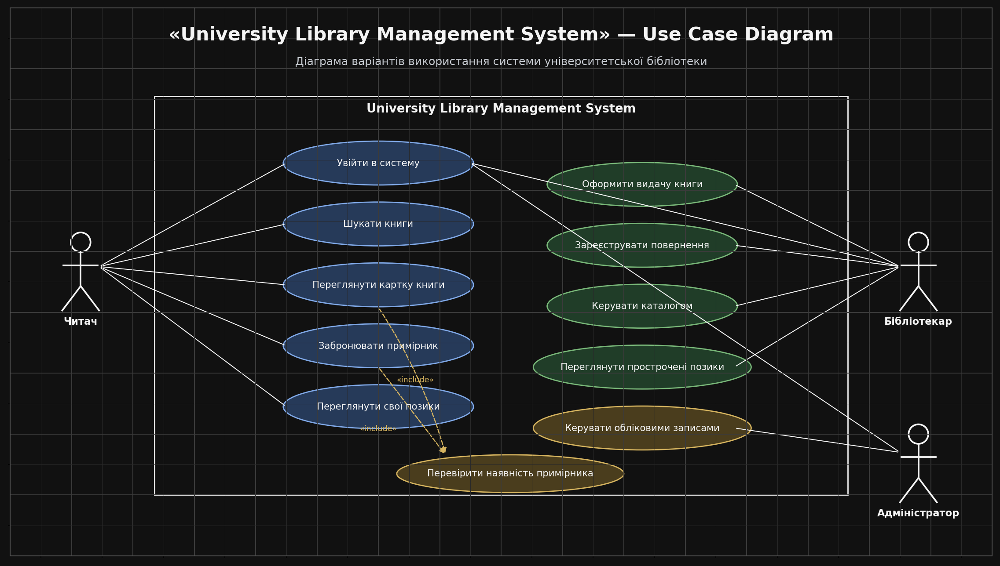
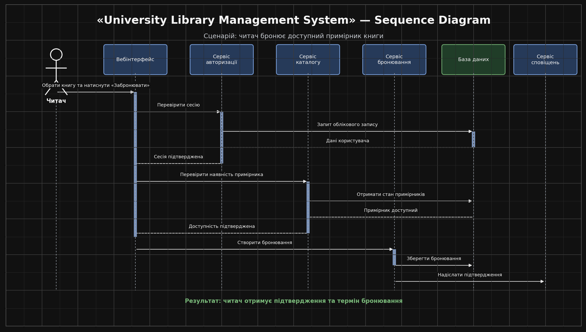
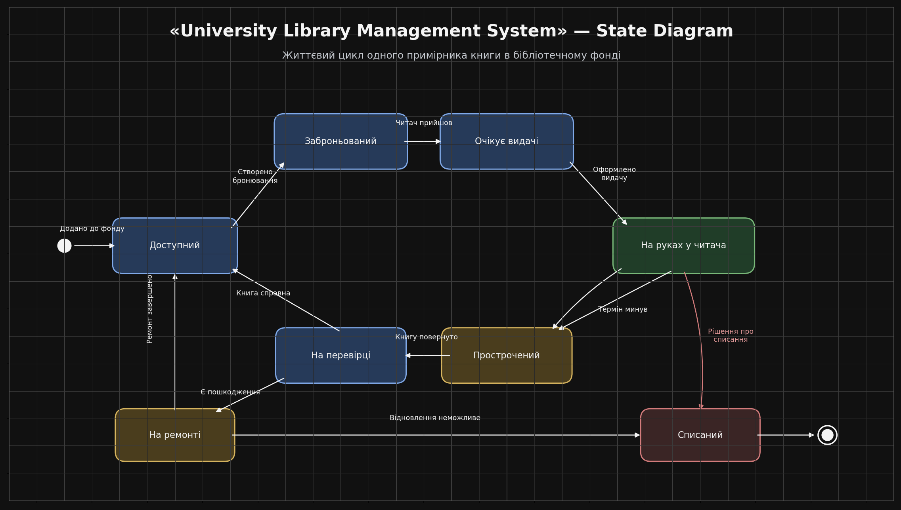
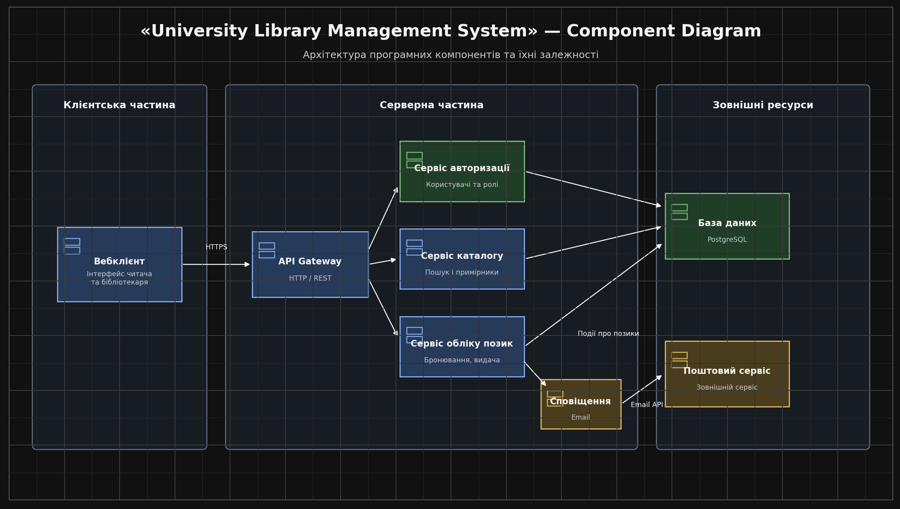

# UML-діаграми: University Library Management System

**Проєкт:** система управління університетською бібліотекою  
**Призначення:** автоматизація пошуку, бронювання, видачі та повернення книг.

Усі чотири діаграми описують одну реалістичну систему. Зображення вже оформлені в єдиному темному стилі з UML-позначеннями.

## 1. Use Case Diagram — діаграма варіантів використання

Показує функції системи та ролі користувачів: читача, бібліотекаря й адміністратора. Читач шукає та бронює книги, бібліотекар керує видачею і поверненням, адміністратор — обліковими записами.

## 2. Sequence Diagram — діаграма послідовностей

Показує сценарій бронювання книги: перевірку сесії читача, перевірку наявності примірника, збереження бронювання та надсилання підтвердження.

## 3. State Diagram — діаграма станів

Відображає життєвий цикл примірника книги: від додавання до фонду до бронювання, видачі, повернення, ремонту або списання.

## 4. Component Diagram — компонентна діаграма

Показує структуру системи: вебклієнт, API Gateway, сервіси авторизації, каталогу, обліку позик і сповіщень, базу даних PostgreSQL та зовнішній поштовий сервіс.

---

## Що зробити для здачі

1. Відкрий diagrams.net і створи чотири окремі сторінки.
2. Відтвори на кожній сторінці відповідну діаграму за зображеннями вище, використовуючи фігури з розділу UML.
3. Додай у верхній частині кожної сторінки назву проєкту та тип діаграми.
4. Зроби скриншот кожної діаграми та завантаж у Google Classroom.

**Назви файлів:**
- `UseCase_Прізвище_Група.png`
- `Sequence_Прізвище_Група.png`
- `State_Прізвище_Група.png`
- `Component_Прізвище_Група.png`

> Примітка: PNG-зображення в цьому Markdown — готові візуальні зразки для перенесення у diagrams.net. Самі скриншоти для здачі потрібно зробити з редактора diagrams.net, оскільки викладач просить використовувати UML-фігури.
